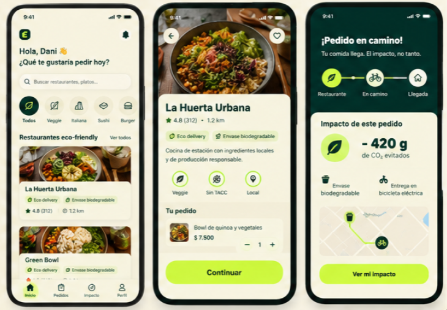

<div align="center">

# 🌱 EcoBite

### Pedí rico. Pedí local. Dejá menos huella.

**Plataforma web de delivery sustentable**


</div>

---

## 🌿 Sobre el proyecto

EcoBite es una plataforma web de delivery sustentable que conecta a los usuarios con restaurantes locales y promueve decisiones de consumo más responsables.

El proyecto busca facilitar la compra de alimentos y generar conciencia sobre el impacto ambiental de cada pedido.

**EcoBite es un trabajo colaborativo:** cada área contribuyó a la planificación, el diseño, el desarrollo, la integración y las pruebas de la plataforma.

## 💻 Tecnologías utilizadas en el frontend

- React y Vite
- JavaScript
- React Router
- Context API
- Tailwind CSS
- API REST y autenticación JWT
- Git y GitHub
- Vercel

> El documento inicial `stack.md` mencionaba Axios como tecnología prevista. Las integraciones revisadas durante el desarrollo utilizan `fetch`; por eso no se presenta Axios como dependencia confirmada.

## 🚀 Funcionalidades

### 👤 Usuarios

- Registro de usuarios e inicio de sesión con autenticación JWT.
- Navegación adaptada al rol del usuario.
- Protección de rutas privadas.
- **Pendiente:** recuperación de contraseñas, aún no implementada en Backend.

### 🍽️ Restaurantes y productos

- Listado de restaurantes y productos disponibles.
- Páginas de detalle e información de los restaurantes.
- Mensajes para estados de carga, error y listas vacías.

### 🛒 Carrito de compras

- Agregar y eliminar productos.
- Modificar cantidades y calcular el total.
- Conservar el carrito mediante `localStorage`.

### 📦 Pedidos y direcciones

- Registro y selección de direcciones de entrega.
- Selección de opciones disponibles para la entrega.
- Confirmación de pedidos mediante la API REST.
- Pantalla de confirmación con número de pedido, total e impacto ambiental.

### 📊 Panel administrativo

- Acceso restringido a administradores.
- Visualización de estadísticas y pedidos recientes.
- Indicadores de actividad e impacto ambiental.

### 🌎 Sustentabilidad

- Calculadora de CO₂.
- Información sobre ahorro de emisiones asociado a pedidos.
- Promoción del consumo local y responsable.

### 📱 Diseño adaptable

- Interfaz responsive para celulares y computadoras.
- Menú de navegación móvil.
- Mensajes de carga y error para mejorar la experiencia de uso.

## 🎨 Diseño e interfaz

El proyecto incorpora recursos visuales e identidad gráfica desarrollados por el equipo de Diseño Gráfico, en coordinación con UX/UI.


### Mockups de la experiencia móvil

<div align="center">



*Diseños compartidos por el equipo de EcoBite. Créditos: UX/UI y Diseño Gráfico.*

</div>

Los mockups muestran una propuesta visual de la experiencia móvil. Algunas pantallas o funcionalidades pueden diferir de la versión implementada.

## ⚙️ Instalación y ejecución local

### Requisitos

- Node.js
- npm
- Git

### 1. Clonar el repositorio

```bash
git clone https://github.com/crysty72/ecobite-frontend.git
```

### 2. Ingresar a la carpeta

```bash
cd ecobite-frontend
```

### 3. Instalar dependencias

```bash
npm install
```

### 4. Configurar las variables de entorno

Crear un archivo `.env` en la raíz del proyecto.

Para utilizar un backend local:

```env
VITE_API_URL=http://localhost:3000/api/v1
```

Para conectarse al backend desplegado en Render:

```env
VITE_API_URL=https://back-ecobyte.onrender.com/api/v1
```

### 5. Iniciar el servidor de desarrollo

```bash
npm run dev
```

Abrir la dirección local indicada por Vite.

### 6. Verificar y generar la versión de producción

```bash
npm run lint
npm run build
```

## 🌐 Despliegue

- **Aplicación web:** [EcoBite en Vercel](https://ecobite-frontend-five.vercel.app/)
- **Repositorio:** [EcoBite Frontend en GitHub](https://github.com/crysty72/ecobite-frontend)

El frontend está desplegado en Vercel y utiliza `VITE_API_URL` para conectarse a la API REST alojada en Render. El proyecto incluye reglas de reescritura para permitir la navegación con React Router en producción.

> La disponibilidad de restaurantes, productos y pedidos depende de los datos cargados en el backend.

## 👥 Equipo de desarrollo y agradecimientos

EcoBite fue desarrollado por un equipo multidisciplinario. Reconocemos el aporte de todas las áreas involucradas:

| Integrante o equipo | Área / contribución |
| --- | --- |
| **Cristina Carrizo** | Frontend: interfaz, navegación, autenticación, carrito, integración con API y despliegue. |
| **Juan Carlos Pubill** | Project Management: coordinación y seguimiento del proyecto. |
| **Tincho** *(nombre completo por confirmar)* | Backend: API REST, autenticación, persistencia e integración. |
| **Micaela** *(apellido por confirmar)* | UX/UI: diseño de experiencia e interfaces. |
| **Victoria** *(nombre completo por confirmar)* | Data Analytics: análisis de datos y métricas. |
| **Simón** *(apellido por confirmar)* | QA: pruebas y control de calidad. |
| **Equipo de Diseño Gráfico** *(integrantes por confirmar)* | Identidad visual, recursos gráficos e iconografía. |

> Los nombres parciales y los créditos pendientes deben verificarse con el equipo antes de dar por definitiva esta sección. Si participaron más personas, corresponde agregarlas.

### Mi participación — Frontend Developer

Como desarrolladora frontend, trabajé en:

- Componentes e interfaces con React y Tailwind CSS.
- Navegación y rutas protegidas.
- Integración con los servicios de Backend.
- Carrito, direcciones y flujo de compra.
- Panel administrativo y visualización de información.
- Pruebas funcionales, correcciones responsive y despliegue en Vercel.

## 📄 Estado del proyecto

El frontend se encuentra **publicado en Vercel y conectado con la API de producción** alojada en Render.

Se verificaron flujos de registro e inicio de sesión, registro de direcciones y compras de prueba desde computadora y celular, con confirmación de pedidos e información sobre ahorro de CO₂.

La recuperación de contraseñas quedó identificada como **mejora pendiente de Backend**. Las validaciones integrales de QA y las mejoras futuras se coordinan con el equipo.
