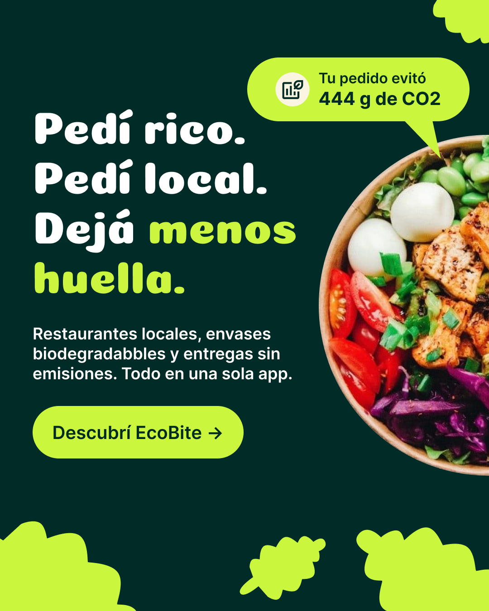

<div align="center">

# 🌱 EcoBite

### Pedí rico. Pedí local. Dejá menos huella.

**Plataforma web de delivery sustentable**



</div>

---

## 🌿 Sobre el proyecto

EcoBite es una plataforma web de delivery sustentable que conecta
a los usuarios con restaurantes locales y promueve decisiones de
consumo más responsables.

El proyecto busca facilitar la compra de alimentos y generar
conciencia sobre el impacto ambiental de cada pedido.

## 💻 Tecnologías utilizadas

- React
- Vite
- JavaScript
- Tailwind CSS
- React Router
- Context API
- API REST
- Git y GitHub
- Vercel

---

## 🚀 Funcionalidades

### 👤 Usuarios
- Registro de nuevos usuarios.
- Inicio de sesión con autenticación JWT.
- Navegación adaptada al tipo de usuario.
- Protección de rutas privadas.

### 🍽️ Restaurantes y productos
- Visualización de restaurantes disponibles.
- Consulta de productos y sus detalles.
- Información de los restaurantes.
- Estados de carga, error y listas vacías.

### 🛒 Carrito de compras
- Agregar productos al carrito.
- Modificar cantidades.
- Eliminar productos.
- Calcular el total de la compra.
- Conservar el carrito mediante localStorage.

### 📦 Pedidos
- Formulario para confirmar pedidos.
- Integración con la API REST.
- Confirmación de compra.
- Información sobre el impacto ambiental del pedido.

### 📊 Panel administrativo
- Acceso restringido a administradores.
- Visualización de estadísticas.
- Consulta de pedidos recientes.
- Indicadores de actividad e impacto ambiental.

### 🌎 Sustentabilidad
- Calculadora de CO₂.
- Información sobre ahorro de emisiones.
- Promoción de restaurantes locales y consumo responsable.

### 📱 Diseño responsive
- Interfaz adaptable a celulares y computadoras.
- Navegación móvil.
- Mensajes de error y carga para mejorar la experiencia.

---

## ⚙️ Instalación y ejecución local

### Requisitos previos

- Node.js
- npm
- Git

### 1. Clonar el repositorio

```bash
git clone https://github.com/crysty72/ecobite-frontend.git
```

### 2. Ingresar a la carpeta

```bash
cd ecobite-frontend
```

### 3. Instalar dependencias

```bash
npm install
```

### 4. Configurar las variables de entorno

Crear un archivo `.env` en la raíz del proyecto:

```env
VITE_API_URL=http://localhost:3000/api/v1
```

Para conectarse al backend desplegado en Render, utilizar:

```env
VITE_API_URL=https://back-ecobyte.onrender.com/api/v1
```

### 5. Iniciar el servidor de desarrollo

```bash
npm run dev
```

Abrir en el navegador la dirección local indicada por Vite.

### 6. Generar la versión de producción

```bash
npm run build
```

---

## 🌐 Despliegue

El frontend está desplegado en Vercel.

**Aplicación web:** [Visitar EcoBite](https://ecobite-frontend-five.vercel.app/)

**Repositorio:** [GitHub - EcoBite Frontend](https://github.com/crysty72/ecobite-frontend)

El proyecto utiliza variables de entorno para configurar la conexión con la API REST y reglas de reescritura para permitir la navegación con React Router en producción.

> **Nota:** La disponibilidad de restaurantes, productos y pedidos depende de los datos cargados en la base de datos del backend.

---

## 👥 Equipo de desarrollo

EcoBite es un proyecto colaborativo desarrollado por un equipo
multidisciplinario.

### Áreas de trabajo

- **Frontend:** desarrollo de la interfaz, navegación, carrito,
  autenticación e integración con la API.
- **Backend:** desarrollo de la API REST, autenticación y base de datos.
- **UX/UI:** diseño de interfaces y experiencia de usuario.
- **Diseño Gráfico:** identidad visual, recursos gráficos e iconografía.
- **Data Analytics:** análisis de datos y métricas.
- **QA:** pruebas funcionales y control de calidad.
- **Project Management:** coordinación y seguimiento del proyecto.

### Mi participación

**Cristina Carrizo — Frontend Developer**

Responsabilidades:
- Desarrollo de componentes con React.
- Implementación de interfaces responsive con Tailwind CSS.
- Integración del frontend con la API REST.
- Implementación de autenticación y rutas protegidas.
- Desarrollo del carrito y flujo de compra.
- Integración del dashboard administrativo.
- Pruebas, correcciones y despliegue en Vercel.

---

## 📄 Estado del proyecto

Proyecto en etapa de integración y pruebas finales de producción.

El frontend se encuentra desplegado en Vercel y conectado
con el backend alojado en Render.

La carga de datos de prueba y la validación de los flujos
completos se están coordinando con el equipo de Backend y QA.